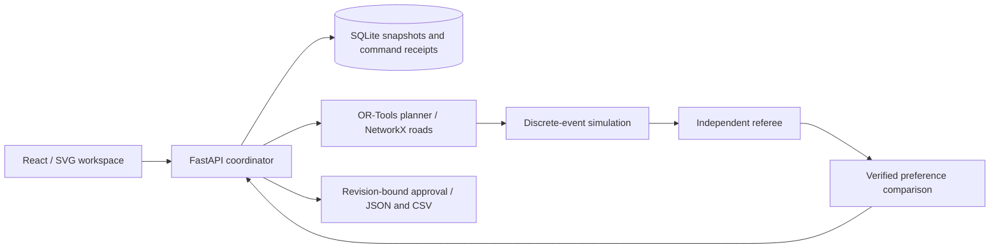

# Architecture

FORK is a local Python service and React single-page application. Deterministic planning and physical simulation produce persisted evidence; the browser projects that evidence onto a playback clock.

## Boundaries

| Component | Responsibility | Source |
| --- | --- | --- |
| Scenario | Seeded synthetic graph, demand, inventory and shifts; canonical hash | `backend/fork_engine/scenario.py` |
| Planner | Initial routes, bounded policy coefficients, residual recovery and diagnostic baselines | `backend/fork_engine/planner.py` |
| Simulator | Timed physical operations, breakdown, custody, trajectories and events | `backend/fork_engine/simulation.py` |
| Referee | Independently replay evidence, reject violations and recompute metrics | `backend/fork_engine/verifier.py` |
| Coordinator | World isolation, common shock, counterfactual runs and API lifecycle | `backend/main.py` |
| Comparison | Eligibility, normalized weights, scores, ties and Pareto set | `backend/comparison.py` |
| Persistence | Transactional experiment JSON snapshots and idempotency receipts | `backend/store.py` |
| Frontend | Local SVG maps, replay, controls, inspectors and downloads | `frontend/src/` |

The referee uses Python's standard library and does not import planner or simulator validation helpers. It treats the initial scenario as authoritative; it does not certify that scenario's real-world truth. The API replaces displayed world metrics with the referee's independently computed metrics.

## Experiment lifecycle

`POST /api/experiments` creates a scenario, deep-copies it for isolated worlds, computes three policies through a three-worker thread pool, verifies them, computes greedy/neutral diagnostic benchmarks, and saves revision 1. Each experiment retains its original `baseline_worlds`.

A breakdown recomputes from those original plans with the identical vehicle and time in every world. Each policy runs both with adaptation and without it. Adaptive worlds retain the verified no-adaptation metrics, verification receipt, recovery gain, and deltas from the unshocked reference. Repeated shock selection replaces the current branch from the original plans; it does not accumulate multiple failures.

Preference updates rescore existing verified outcomes; they do not rerun route optimization. Both preferences and breakdown changes increment the revision and clear approval. Approval requires the caller's current revision and a valid receipt, recording evidence and comparison hashes. Export checks the current revision and evidence hash again.

SQLite stores experiment snapshots and command receipts atomically. It is not an append-only event-sourcing database or a multi-user distributed coordination system. Mutation serialization is an in-process lock; this local deployment should use one backend worker.

## API surface

| Method and route | Behavior |
| --- | --- |
| `GET /api/health` | Mode, synthetic-data and external-dispatch flags |
| `GET /api/scenario?seed=26` | Synthetic starting inputs |
| `POST /api/experiments` | Create; body `{ "seed": 26 }` |
| `GET /api/experiments/{id}` | Saved experiment and current revision |
| `POST /api/experiments/{id}/disrupt` | Body `{ "vehicle_id": "A", "time": 1500 }` |
| `POST /api/experiments/{id}/preferences` | Nonnegative `coverage`, `equity`, `cost` weights in [0,1], positive total |
| `POST /api/experiments/{id}/approve` | Body `{ "world_id": "velocity", "revision": 2 }`; actual current revision required |
| `GET /api/experiments/{id}/export?world_id=velocity&format=json` | Current approved evidence; `csv` also supported |
| `GET /api/experiments/{id}/events` | Finite saved-event SSE replay; `Last-Event-ID` cursor supported |

Launch, disruption and approval accept `Idempotency-Key`; reusing a key with a different body fails with 409. The event stream replays existing computed records; it is not a live model-token or telemetry stream. Interactive API documentation is at `/docs`.

## Evidence and outputs

Scenario hash binds initial inputs. Recovery metadata binds the actual shock snapshot and locked commitments. The referee event hash covers events, trajectories and completed deliveries. These hashes support internal integrity inspection, not external attestation or a signed audit.

JSON exports contain scenario, disruption, selected world, verification, comparison, decision and limitations, marked synthetic with external dispatch disabled. CSV exports contain actual simulated completed deliveries, fixed volunteer IDs, completion times and revision. They are not instructions sent to operators.

The backend serves `frontend/dist` in demo mode. Development uses Vite's same-origin `/api` proxy. There are no map-tile, font, model-provider or analytics runtime dependencies. Dependencies still need an initial online install. See [SIMULATION.md](SIMULATION.md) for physical semantics and [docs/CONTRACT.md](docs/CONTRACT.md) for the integration contract.
