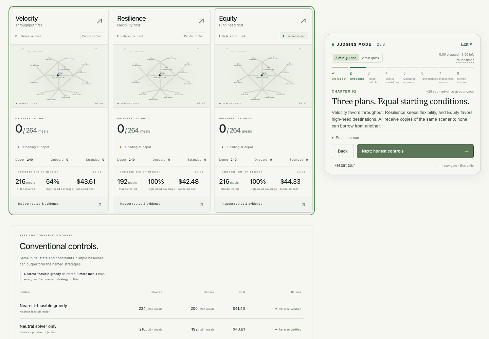

# FORK

**Business & Enterprise · Operations planning · Food-bank delivery resilience**

**Rehearse before you commit.**

A delivery vehicle breaks down. Which meals can still arrive, and what does changing the plan actually recover? FORK lets an operations coordinator rehearse that decision before dispatch: compare three planning strategies, apply the same breakdown, inspect independently checked results, then approve a simulated plan for export.

The primary demo is a **synthetic food-bank delivery mission**. FORK runs locally in **Deterministic Planner Mode**: OR-Tools proposes routes, a simulator executes them, and a separate referee reconstructs movement, cargo and results. A person makes the final choice. Runtime uses no language model, deepagents or API key. OpenAI Codex substantially assisted development.

**Start here:** [3-minute guided walkthrough](http://127.0.0.1:8000/?view=logistics&tour=1) · [2-minute judging cut](http://127.0.0.1:8000/?view=logistics&tour=1&pace=120) · [presentation guide](docs/JUDGING_MODE.md)

**Watch the demo:** [numbered, narrated submission film](artifacts/FORK-submission-demo.mp4) · [captions](artifacts/FORK-submission-demo.srt) · [spoken pitch](docs/PITCH.md)

The three-minute mode is for learning and rehearsal. The supplied event packet caps both the submitted video and in-person presentation at **two minutes**. Start the local server below before opening either guide.



## Run the food-bank demo

Prerequisites: Python **3.13**, Node.js **24**, npm and Make. `uv` is optional.

```sh
make setup
make demo
```

Open **http://127.0.0.1:8000/?view=logistics&tour=1** for the guided food-bank story, or **http://127.0.0.1:8000/?view=logistics** for the workspace. The root page opens Scenario Studio; its **Try the food-bank demo** link reaches the same logistics view. Keep the server terminal running. `make demo` builds the frontend and serves it through FastAPI on one origin; use one backend worker.

In judging mode, use its **Next** buttons to follow the eight chapters. For direct exploration in the ordinary workspace:

1. Choose **Fork the mission**: 240 meals available for 264 requested, 12 orders and three vehicles.
2. Compare Velocity, Resilience and Equity. Their names describe different priorities and reserve settings, not autonomous agents or a guaranteed winner.
3. Select a vehicle and breakdown time. Every isolated world receives the same shock.
4. Compare **adaptive execution with the same initial plan under the same shock without replanning**. This fixed-plan control isolates modeled recovery; the unshocked reference answers a different question.
5. Inspect a referee receipt, adjust preferences, approve the current evidence and download JSON or a CSV of simulated completed deliveries.

Export does not dispatch vehicles or contact volunteers. Changing the experiment or preferences invalidates approval. Reset creates a new experiment and preserves saved history.

## Read the comparison honestly

The conventional greedy baseline initially delivers more meals than the named policies:

| Seed-26 initial plan | Simulated meals delivered |
|---|---:|
| Nearest-feasible greedy | **224** |
| Neutral solver | 216 |
| Velocity | 216 |
| Resilience | 192 |
| Equity | 216 |

For the recorded **vehicle A breakdown at elapsed 1,500 seconds (09:25)**, the paired comparison is:

| Strategy | Adaptive | Fixed plan, same shock | Recovery gain |
|---|---:|---:|---:|
| Velocity | 168 | 144 | +24 |
| Resilience | 168 | 120 | +48 |
| Equity | 168 | 144 | +24 |

All three finish with the same delivered meals in this example. Resilience's larger gain is relative to its weaker control. Other supported shocks can produce different results, ties or zero gains. These are consequences inside the declared simulator, not meals delivered in the world or proof that the named policies outperform conventional optimization.

## Scenario Studio: author another bounded scenario

Scenario Studio is an existing secondary capability at **http://127.0.0.1:8000**. Describe an operational issue; a bounded deterministic interview asks for missing facts and quotes conflicting claims. Review the agreed assumptions, then run three resource/task schedules, apply common outages and inspect the independent checks before approval/export.

The interview uses phrase recognition and clarification, not unrestricted language understanding. Its generic workflow model supports checkpointable jobs, resource pools, skills, dependencies, deadlines, materials, budgets and capacity outages. It does not infer routing or domain physics. The typed clarification/model contract is a possible future AI authoring boundary; no provider is connected. See [conversational intake](docs/CONVERSATIONAL_INTAKE.md) and [Scenario Studio](docs/SCENARIO_STUDIO.md).

## Implementation, checks and limits

FastAPI coordinates transactional SQLite snapshots and idempotent commands. React, TypeScript and Vite render synchronized maps, timelines, evidence and human approval. The logistics engine uses directed-road routing, explicit load/service durations, stranded cargo and bounded recovery. The independent standard-library referee recomputes movement, custody, timing and metrics without importing planner/simulator validation helpers.

```sh
make test          # Python and frontend model checks, typecheck/build
make test-browser  # Actual browser journey; needs a running demo server
make dev           # API on :8000 and Vite on :5173
make reset         # New seed-26 experiment; preserve saved history
```

See [TESTING.md](TESTING.md) for executed checks, snapshot-specific results and their limits. Initial dependency installation and any missing browser download require network access. Experiments persist in `data/fork.sqlite`; set `FORK_DB_PATH` before startup to use a different database. The local command serializer does not support multiple Uvicorn workers.

Roads, orders, priorities, volunteer identities, costs and emissions are synthetic. Logistics supports one depot, one breakdown per experiment, fixed drivers, indivisible orders and deterministic travel. Initial routes make one trip; each healthy vehicle may make at most one recovery reload. Failed cargo cannot be rescued or transferred. No production dispatch, live telemetry, real-data integration, global optimality or field-validation claim is made.

## Presentation and source

- [Current presentation release evidence](docs/PRESENTATION_RELEASE.md) · [submission pack and track recommendation](SUBMISSION_READY.md) · [submission demo](artifacts/FORK-submission-demo.mp4)
- [Guided judging mode](docs/JUDGING_MODE.md) · [3-minute rehearsal / 2-minute click guide](DEMO.md) · [spoken scripts and FAQ](docs/PITCH.md) · [copy-ready Devpost draft](DEVPOST.md)
- [Simulation and metric definitions](SIMULATION.md) · [architecture and API](ARCHITECTURE.md)
- [Runtime roles and AI disclosure](AGENTS.md) · [tests and evidence](TESTING.md)
- [Engine evidence](docs/ENGINE_REPORT.md) · [independent referee evidence](docs/VERIFIER_REPORT.md)
- [Scenario Studio](docs/SCENARIO_STUDIO.md) · [conversational authoring](docs/CONVERSATIONAL_INTAKE.md) · [roadmap](ROADMAP.md)

Source repository: **[ahmedhxssam/fork-ai](https://github.com/ahmedhxssam/fork-ai)**. The earlier judge-readiness UI and 92-second media were published at tested commit [`e37a0ee`](https://github.com/ahmedhxssam/fork-ai/commit/e37a0ee79849a42f021fdf520e8473f5ae4ddab4); anonymous source/media hashes were verified. See [publication evidence](docs/PUBLICATION.md). That historical [92-second narrated judge walkthrough](artifacts/FORK-judge-demo.mp4) contains genuine browser actions with a local system voice; [captions](artifacts/FORK-judge-demo.srt) and [its verification](docs/JUDGE_READINESS.md) are included. Publication of the newer guided-tour/submission-video update requires separate release evidence. Earlier silent [logistics](artifacts/FORK-demo-silent.webm), [Studio](artifacts/FORK-studio-demo-silent.webm) and [conversation](artifacts/FORK-conversation-demo-silent.webm) recordings remain historical. The existing [Devpost entry](https://devpost.com/software/fork-ai-pmeja0) was observed as submitted on November 15; its name, story, thumbnail and gallery were updated in Dia and its submitted status was verified. No hosted app is claimed.

Built with Python, FastAPI, Pydantic, Uvicorn, SQLite, OR-Tools, NetworkX, React, TypeScript, Vite, pytest, HTTPX and Playwright. Exact dependencies are in `requirements.lock` and `frontend/package-lock.json`.

**AI assistance:** OpenAI Codex substantially assisted architecture, implementation, tests, debugging, review and documentation. This development assistance is separate from runtime capability. No human-authorship percentage, organizer eligibility ruling, sponsor integration or award outcome is asserted.
