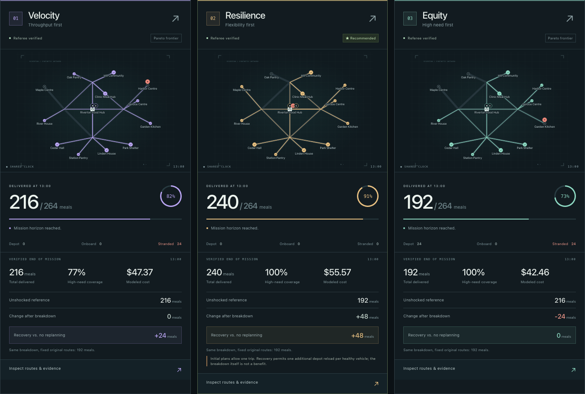

# FORK

**Rehearse a decision before its consequences become real.**

FORK is a local decision laboratory for a synthetic food-bank mission. It computes three logistics strategies from the same resources, applies the same vehicle breakdown to each, and shows what recovery changes. An independent referee reconstructs the physical evidence before an outcome can be recommended or approved.

The current release runs in **Deterministic Planner Mode**. It uses OR-Tools and NetworkX; it does not call a language model, use deepagents, or require an API key. Playback animates computed event histories. It is not live vehicle telemetry.

## Run locally

Prerequisites: Python **3.13**, Node.js **24**, npm, and Make. `uv` is optional. Install dependencies while online; the installed application uses only localhost during operation.

```sh
make setup
make demo
```

Open **http://127.0.0.1:8000**. `make demo` builds the frontend and serves it through FastAPI on one origin. Keep that terminal running. No hosted service is required. Run one backend worker; the local command serializer does not support multiple Uvicorn workers.



```sh
make dev           # API on :8000 and Vite on :5173
make test          # Python suite, frontend typecheck and production build
make test-browser  # Real-browser journey; installs official Chromium if missing
make reset         # Create a new seed-26 experiment; preserve saved history
```

`make setup` creates `.venv` using `uv` when available, otherwise Python 3.13, installs `requirements.lock`, and runs `npm ci` in `frontend/`. Initial setup and a missing browser download require network access. Browser tests require a running demo server. See [TESTING.md](TESTING.md) for individual commands and evidence boundaries.

Experiments persist in `data/fork.sqlite`; set `FORK_DB_PATH` before starting the backend to use another database. Reset starts a new experiment rather than deleting previous records. Resume an experiment through its saved browser session.

## What to try

1. Launch the Riverton mission: 240 meals available for 264 requested, 12 orders, three vehicles and fixed volunteers.
2. Compare Velocity, Resilience and Equity on synchronized maps and clocks.
3. Choose vehicle A, B or C and a breakdown time. Apply the same shock to all worlds.
4. Read **recovery gain**: adaptive execution minus the same initial plan under the same shock without replanning. The unshocked reference answers a different question.
5. Change coverage, high-need service and cost preferences. Inspect actual routes, cargo, events and referee checks.
6. Approve a verified revision and download JSON evidence or a CSV of simulated completed deliveries.

Export never dispatches a vehicle or contacts a volunteer. Changing the experiment or preferences invalidates approval.

## What the comparison means

The policies share the routing method and bounded search budget, with different published objective coefficients and reserve settings. Their names describe preferences, not proven superiority. The default initial fixture delivers **Velocity 216, Resilience 192, Equity 216 meals**. A conventional nearest-feasible greedy comparator delivers **224**; a neutral solver comparator delivers **216**. The greedy result beats all three named policies on aggregate initial meals. This is a decision-inspection tool, not evidence that the policies outperform conventional optimization.

The distinctive demonstration is the paired recovery comparison: hold the scenario, initial plan, shock resource and shock time fixed; change whether replanning is allowed. Inspect both outcomes and their evidence. This isolates the modeled effect of adaptation within this simulator, not a causal estimate for real food-bank operations.

## Implementation and evidence

- React/TypeScript/Vite workspace with local SVG roads, three worlds, playback, preference comparison and evidence inspection.
- FastAPI coordinator, transactional SQLite snapshots, idempotent launch/shock/approval commands and revision-bound exports.
- Directed-road routing, explicit timed loads/services, stranded cargo and bounded recovery reloads.
- Independent standard-library referee that reconstructs custody, movement, timing and metrics without importing planner/simulator validation helpers.

The final Python run is **84 passed**, with **4 frontend model tests** and **14 real-browser checks** passing. The referee report records a **6,780-world** finite sweep with zero invalid receipts and zero recomputed-metric differences; the final recovery-load fix adds 471 fixture classifications and 270 generated boundary checks. Typecheck, production build, actual JSON/CSV downloads, all vehicle choices, narrow layout, and a fresh local disruption with external origins blocked passed. See [release verification](docs/RELEASE_VERIFICATION.md) and [TESTING.md](TESTING.md). A finite synthetic sweep is not a proof of optimality or operational safety.

The [37-second silent walkthrough](artifacts/FORK-demo-silent.webm) records genuine application behavior, including a preference-sensitive recommendation change and human approval. It is an automated backup clip, separate from the [two-minute narrated pitch](docs/PITCH.md). [Recording provenance](docs/RECORDING_REPORT.md) and [approved example evidence](artifacts/approved-resilience.json) are included.

## Deliberate limits

All roads, orders, priorities, volunteer identities, costs and emissions are synthetic. There is one depot, one breakdown per experiment, fixed drivers, indivisible orders and deterministic travel. Initial routes make one trip; each healthy vehicle may make at most one recovery depot reload. Failed cargo cannot be rescued or transferred. Chilled compatibility is a capacity rule, not food-safety certification. No production dispatch, real data integration, live LLM strategist, general multitrip optimizer or global optimality guarantee is implemented.

## Documentation

- [Architecture and API](ARCHITECTURE.md)
- [Simulation, policies and metric definitions](SIMULATION.md)
- [Deterministic roles and AI disclosure](AGENTS.md)
- [Tests and measured evidence](TESTING.md)
- [Two-minute demo and recording checklist](DEMO.md)
- [Pitch script](docs/PITCH.md)
- [Devpost draft](DEVPOST.md)
- [Roadmap](ROADMAP.md)
- [Engine evidence](docs/ENGINE_REPORT.md) · [Independent referee evidence](docs/VERIFIER_REPORT.md)

Public source: **[github.com/ahmedhxssam/fork-ai](https://github.com/ahmedhxssam/fork-ai)**. The repository was created November 13, 2026 at 11:13 PM Eastern, and anonymous source access was verified. The app runs locally; no hosted deployment or completed competition entry is claimed. [DEVPOST.md](DEVPOST.md) is the submission draft, ready for the owner's final entry review.

## Credits and AI assistance

Built with Python, FastAPI, Pydantic, Uvicorn, SQLite, OR-Tools, NetworkX, React, TypeScript, Vite, pytest, HTTPX and Playwright. Exact installed dependencies are recorded in `requirements.lock` and `frontend/package-lock.json`.

OpenAI Codex provided substantial assistance with architecture, implementation, test authoring, debugging, review and documentation. This development assistance is distinct from runtime capability: the submitted application currently makes no LLM calls. No percentage of human-authored code or organizer eligibility determination is asserted. No sponsor integration or award outcome is claimed.
