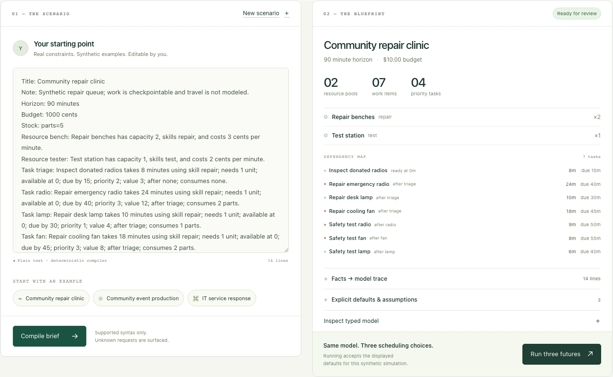

# FORK

**Rehearse a decision before its consequences become real.**

FORK is a local decision laboratory. Its Scenario Studio compiles an editable brief into a typed resource-and-task model, runs three scheduling choices, and compares their response to the same disruptions. Repair clinics, event production and IT response use the same engine. An independent referee reconstructs the evidence before an outcome can be approved.

The current release runs entirely in **deterministic mode**. The bounded brief compiler and workflow scheduler run locally. The retained food-bank logistics lab uses OR-Tools and NetworkX. No language model, deepagents or API key is used. The typed model schema is ready for a later AI authoring adapter; AI-generated simulation models are not claimed today.

## Run locally

Prerequisites: Python **3.13**, Node.js **24**, npm, and Make. `uv` is optional. Install dependencies while online; the installed application uses only localhost during operation.

```sh
make setup
make demo
```

Open **http://127.0.0.1:8000**. `make demo` builds the frontend and serves it through FastAPI on one origin. Keep that terminal running. No hosted service is required. Run one backend worker; the local command serializer does not support multiple Uvicorn workers.



```sh
make dev           # API on :8000 and Vite on :5173
make test          # Python suite, frontend typecheck and production build
make test-browser  # Real-browser journey; installs official Chromium if missing
make reset         # Create a new seed-26 experiment; preserve saved history
```

`make setup` creates `.venv` using `uv` when available, otherwise Python 3.13, installs `requirements.lock`, and runs `npm ci` in `frontend/`. Initial setup and a missing browser download require network access. Browser tests require a running demo server. See [TESTING.md](TESTING.md) for individual commands and evidence boundaries.

Experiments persist in `data/fork.sqlite`; set `FORK_DB_PATH` before starting the backend to use another database. Reset starts a new experiment rather than deleting previous records. Resume an experiment through its saved browser session.

## Start with Scenario Studio

1. Edit the prefilled brief, or choose repair clinic, event production or IT response.
2. Compile and review the extracted resources, jobs, dependencies, source facts and explicit assumptions. Unsupported requests remain visible and block the run.
3. Run three genuinely computed futures and inspect their processing timelines and independent checks.
4. Add resource outages and rerun the same counterfactual for every policy. Compare adaptive execution with a fixed-plan control under the same outages.
5. Adjust preferences, review the current evidence, approve a future and export JSON or worked-segment CSV.

Changing the brief makes old results stale. New scenario starts an empty draft and preserves history. The compiler accepts documented patterns, not arbitrary domain physics. See [Scenario Studio's model, grammar and AI boundary](docs/SCENARIO_STUDIO.md).

## Retained logistics lab

Open **http://127.0.0.1:8000/?view=logistics** or use the studio's logistics link.

1. Launch the Riverton mission: 240 meals available for 264 requested, 12 orders, three vehicles and fixed volunteers.
2. Compare Velocity, Resilience and Equity on synchronized maps and clocks.
3. Choose vehicle A, B or C and a breakdown time. Apply the same shock to all worlds.
4. Read **recovery gain**: adaptive execution minus the same initial plan under the same shock without replanning. The unshocked reference answers a different question.
5. Change coverage, high-need service and cost preferences. Inspect actual routes, cargo, events and referee checks.
6. Approve a verified revision and download JSON evidence or a CSV of simulated completed deliveries.

Export never dispatches a vehicle or contacts a volunteer. Changing the experiment or preferences invalidates approval.

## What the logistics comparison means

The policies share the routing method and bounded search budget, with different published objective coefficients and reserve settings. Their names describe preferences, not proven superiority. The default initial fixture delivers **Velocity 216, Resilience 192, Equity 216 meals**. A conventional nearest-feasible greedy comparator delivers **224**; a neutral solver comparator delivers **216**. The greedy result beats all three named policies on aggregate initial meals. This is a decision-inspection tool, not evidence that the policies outperform conventional optimization.

The distinctive demonstration is the paired recovery comparison: hold the scenario, initial plan, shock resource and shock time fixed; change whether replanning is allowed. Inspect both outcomes and their evidence. This isolates the modeled effect of adaptation within this simulator, not a causal estimate for real food-bank operations.

## Implementation and evidence

- Editable scenario workbench, typed data-only compiler, one generic workflow scheduler and an independent workflow referee.
- React/TypeScript/Vite workspace with workflow processing timelines and a retained SVG logistics lab, playback, preference comparison and evidence inspection.
- FastAPI coordinator, transactional SQLite snapshots, idempotent launch/shock/approval commands and revision-bound exports.
- Directed-road routing, explicit timed loads/services, stranded cargo and bounded recovery reloads.
- Independent standard-library referee that reconstructs custody, movement, timing and metrics without importing planner/simulator validation helpers.

The current combined release passes **182 Python tests**, **4 frontend model tests** and **26 real-browser checks**, including both Studio and the retained logistics lab. A separate fresh 1,000-model workflow audit checked **6,000 adaptive/control simulations**, plus nominal/control parity, no future-outage peek and outage-order invariance. See [Studio release verification](docs/STUDIO_RELEASE_VERIFICATION.md) and [TESTING.md](TESTING.md). A finite synthetic sweep is not a proof of optimality or operational safety.

The [47-second Studio walkthrough](artifacts/FORK-studio-demo-silent.webm) records genuine cross-domain compilation, an outage rerun, independent checks, approval and a verified download. It is silent; use the [two-minute spoken pitch](docs/PITCH.md) for narration. [Studio recording provenance](docs/STUDIO_RECORDING_REPORT.md), [approved workflow evidence](artifacts/studio-approved.json), and the original [logistics clip](artifacts/FORK-demo-silent.webm) are included.

## Deliberate limits

Studio examples are synthetic. Its generic model supports checkpointable jobs, resource pools, skills, dependencies, deadlines, materials, work budgets and capacity outages. It does not model routing, stochastic arrivals or physical dynamics. A domain's name does not establish that these assumptions fit it.

The logistics lab has synthetic roads, orders, priorities, volunteer identities, costs and emissions; one depot, one breakdown per experiment, fixed drivers, indivisible orders and deterministic travel. Initial routes make one trip; each healthy vehicle may make at most one recovery depot reload. Failed cargo cannot be rescued or transferred. No production dispatch, real data integration, live LLM strategist or global optimality guarantee is implemented.

## Documentation

- [Architecture and API](ARCHITECTURE.md)
- [Scenario Studio and AI authoring boundary](docs/SCENARIO_STUDIO.md)
- [Simulation, policies and metric definitions](SIMULATION.md)
- [Deterministic roles and AI disclosure](AGENTS.md)
- [Tests and measured evidence](TESTING.md)
- [Two-minute demo and recording checklist](DEMO.md)
- [Pitch script](docs/PITCH.md)
- [Devpost draft](DEVPOST.md)
- [Roadmap](ROADMAP.md)
- [Engine evidence](docs/ENGINE_REPORT.md) · [Independent referee evidence](docs/VERIFIER_REPORT.md)

Public source: **[github.com/ahmedhxssam/fork-ai](https://github.com/ahmedhxssam/fork-ai)**. The repository was created November 13, 2026 at 11:13 PM Eastern, and anonymous source access was verified. The app runs locally; no hosted deployment or completed competition entry is claimed. [DEVPOST.md](DEVPOST.md) is the submission draft, ready for the owner's final entry review.

That public snapshot is the original logistics release. The reviewed Scenario Studio enhancement and its new media are prepared locally; this update does not claim a public upload.

## Credits and AI assistance

Built with Python, FastAPI, Pydantic, Uvicorn, SQLite, OR-Tools, NetworkX, React, TypeScript, Vite, pytest, HTTPX and Playwright. Exact installed dependencies are recorded in `requirements.lock` and `frontend/package-lock.json`.

OpenAI Codex provided substantial assistance with architecture, implementation, test authoring, debugging, review and documentation. This development assistance is distinct from runtime capability: the submitted application currently makes no LLM calls. No percentage of human-authored code or organizer eligibility determination is asserted. No sponsor integration or award outcome is claimed.
